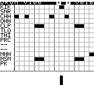

# GAYBOY — Game Boy synth, sequencer & chiptune workstation

Your Game Boy has a music problem. Good. Let's make it worse.

**GAYBOY** is a Game Boy music workstation: a synthesizer, piano-roll sequencer, sample drum machine and performance mixer in a `.gb` ROM. Make chiptune melodies, program beats and play the handheld as a MIDI synth through Arduinoboy.

**[Play in your browser](https://buttholechopper.com/gayboy/)** · **[Download the ROM](https://buttholechopper.com/gayboy/downloads/GAYBOY.gb)** · **[GAYBOY on Y2KCRISIS](https://y2kcrisis.com/~GAYBOY)** · **[Report a bug](https://github.com/dpjpandone/GAYBOY/issues)**



## A tiny handheld music studio

- **Game Boy synthesizer:** native pulse, wave and noise sounds, plus optional experimental synthesis.
- **Piano-roll sequencer:** edit pitches, note lengths and velocities, switch tracks and arrange patterns.
- **Drum machine:** ten PCM sample rows and two noise-drum voices, with kits and per-voice mute/solo.
- **Performance mixer:** pattern pads, channel levels, pan, mute/solo and global tempo.
- **MIDI instrument:** use Arduinoboy in mGB mode to play from external MIDI gear.
- **Browser play:** the SameBoy-based player includes an interactive tutorial, local saves and shared beats.
- **Pixel-art intro:** a handheld-scale cinematic before the workstation opens.

Seven logical tracks share four physical sound channels. Sample drums share the wave output.

## Make your first beat

1. Open the browser player and power on, or download the ROM for a compatible emulator or flash cartridge.
2. Press **Start** to skip the intro. Hold Start, choose a page with Up/Down and release Start to open it.
3. In the sequencer, move with the D-pad and plot notes with **A**. **Select + A** starts/stops playback.
4. Try **Play tutorial** in the browser for guided practice. Export saves to keep a backup.

The current development cartridge is **1 MiB, MBC5 with battery-backed 32 KiB RAM**, targeting DMG and Game Boy Color. Physical hardware/audio validation is still in progress. Back up saves and expect changes. See the [development notes and controls](docs/development-notes.md) for current limitations, including timing measurements.

## User guides (draft)

The illustrated user guide is nearly finished and available for review:

- [Read the illustrated guide online](https://buttholechopper.com/gayboy/guide/)
- [Download the PDF](https://buttholechopper.com/gayboy/guide/GAYBOY-user-guide-review.pdf)
- [Browse the guide source and screenshots](docs/user-guide/)

These are review drafts; some features still need a final walkthrough.

## Build from source

Use Windows PowerShell, Python 3 and GBDK 4.5.0 installed under `tools/gbdk/` (toolchain not included). Full asset generation also needs the project's local audio inputs; audio/video media are excluded from Git. A source checkout alone may need those inputs before a full rebuild.

```powershell
./build.ps1
python tools/check_rom.py
```

Output: `build/GAYBOY.gb`. ROMs, build output, recordings and credentials are excluded from Git. Use the live download above to try the packaged cartridge.

## Explore the project

| Directory | Contents |
| --- | --- |
| `src/` | Game Boy engine, synth, sequencer and UI |
| `tools/` | Asset generation, builds, packaging and verification |
| `website/` | Standalone GAYBOY site and SameBoy browser player |
| `network/` | Y2KCRISIS social site and embedded GAYBOY app |
| `docs/` | Development notes and user-guide material |

See [website notes](website/README.txt), [Y2KCRISIS setup](network/README.md), and [development notes](docs/development-notes.md). Emulator tests use PyBoy; browser checks use Playwright; network checks use isolated PHP/SQLite storage. Never run account-creating tests against production.

## Bugs and contributions

[Open an issue](https://github.com/dpjpandone/GAYBOY/issues) with the ROM version, emulator or hardware, steps to reproduce, and expected versus actual behavior. Include a screenshot or save when useful, without private information. Keep contributions focused and describe how you checked them.

## Credits and licensing

GAYBOY is by [dpjpandone](https://github.com/dpjpandone). Browser emulation uses [SameBoy](https://sameboy.github.io/); its license is included in the emulator directory. Third-party components retain their own notices. There is currently no project-wide license granting reuse of GAYBOY code or artwork. Nintendo and Game Boy are trademarks of their respective owners; this is an independent homebrew project.
